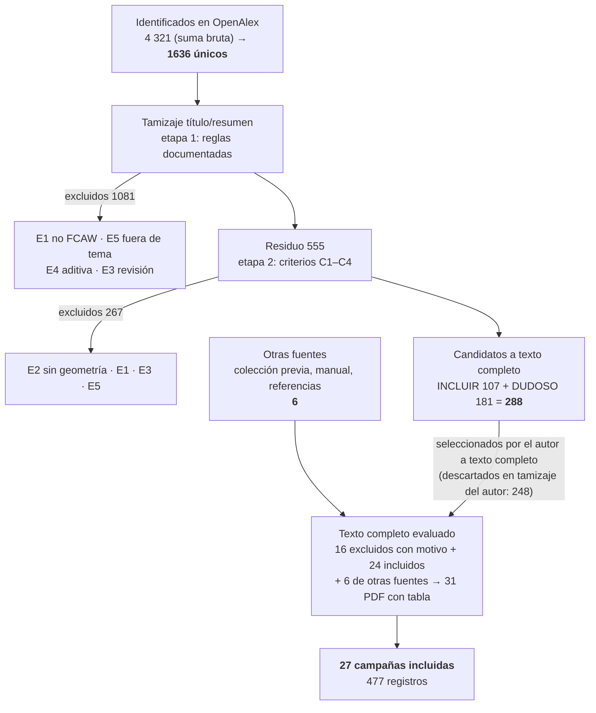

# Flujo PRISMA-IPD — búsqueda documentada del 2026-09-14, tamizaje consolidado el 2026-09-15

## Cifras

| Caja | n |
|---|---|
| Registros identificados en OpenAlex (15 cadenas, 4 ejes, suma bruta con solapes) | 4 321 |
| **Registros únicos tras eliminar duplicados por identificador** | **1636** |
| Tamizados por título y resumen — etapa 1, reglas documentadas | 1636 |
| Excluidos en etapa 1 | 1081 |
| Residuo a etapa 2, juicio por criterios C1–C4 | 555 |
| Excluidos en etapa 2 | 267 |
| **Candidatos a texto completo** (INCLUIR 107 + DUDOSO 181) | **288** |
| Identificados por otras fuentes (colección previa, búsqueda manual, referencias cruzadas) | 6 |
| Estudios incluidos en el corpus (campañas con datos propios) | 27 |

### Exclusiones por código
- Etapa 1 (reglas): {'E1_NO_FCAW': 871, 'E5_FUERA_TEMA': 114, 'E4_ADITIVA': 61, 'E3_SIN_DATOS': 35}
- Etapa 2 (agentes): {'E2_SIN_GEOMETRIA': 211, 'E1_NO_FCAW': 38, 'E3_SIN_DATOS': 14, 'E5_FUERA_TEMA': 4}

## Prueba de sensibilidad
De los **24 estudios del corpus** presentes entre los 1636 registros: **INCLUIR 21 · DUDOSO 3 · EXCLUIR 0**.
Sensibilidad del tamizaje (no excluidos / 24) = **100%**. Los DUDOSO son registros sin resumen en OpenAlex; el protocolo los envía a texto completo.

## Cobertura
- Candidatos de agosto (317) presentes entre los 1636: 77
- Corpus (27 con datos propios): 24 recuperados por la búsqueda documentada; 6 filas de `01_ESTUDIOS` no recuperadas (Paiva 2010, Zhang 2016, Guimarães 2020, Singh 2021, Solovyov 2023, Odhiambo 2025: portugués, ucraniano o sin DOI) → *otras fuentes*.

## Registro de destino por registro (`TAMIZAJE_FINAL.csv`, columnas `destino_PRISMA` y `motivo_PRISMA`)

| Destino | n | Cómo se documenta |
|---|---|---|
| EXCLUIDO_TAMIZAJE (reconstruido, etapas 1 y 2) | 1 348 | código E1–E5 y motivo por registro |
| EXCLUIDO_TAMIZAJE_AUTOR | 248 | tamizaje del autor, agosto 2026: no seleccionado a texto completo. **PRISMA reporta las exclusiones de tamizaje como conteo; el motivo por registro solo se exige a texto completo** |
| EXCLUIDO_TEXTO_COMPLETO | 16 | motivo por registro: `TRIAJE_nueva.csv` y `CONCILIACION_TAMIZAJE.csv` |
| INCLUIDO | 24 | en el corpus (`01_ESTUDIOS`) |

**Acuerdo entre evaluadores.** El tamizaje reconstruido se ejecutó con la regla *"ante la duda, INCLUIR"*
(sensibilidad máxima) y marca INCLUIR 75 registros que el autor descartó en agosto. Es el desacuerdo esperado
entre un tamizador que maximiza sensibilidad y un evaluador de dominio con acceso a vista previa; **prevalece
el juicio del autor**, y la sensibilidad del 100 % sobre los 24 del corpus muestra que el proceso reconstruido
no pierde nada de lo que el autor incluyó. Los 75 quedan listados en `POR_DESCARGAR_75.csv` por transparencia,
no como pendiente.

**Cobertura del texto completo.** Del total de textos completos evaluados —31 PDF del corpus más los de
`papers_FCAW/nueva` y los descartados de `T1_estado.csv`—, todos tienen registro. No hay candidato
"nunca evaluado": los que no tienen PDF fueron descartados por el autor en la etapa de tamizaje.

## Diagrama

## Archivos
`registros.csv` (entrada) · `veredicto_reglas.csv` (etapa 1) · `veredicto_residuo_1..6.csv` (etapa 2) · `TAMIZAJE_FINAL.csv` (consolidado) · `PROTOCOLO_TAMIZAJE.md` · `_scripts/tamizaje_1636_reglas.py`

## Conciliación 2026-10-01 (añadida a mano; se pierde si se vuelve a ejecutar `tamizaje_1636_consolidar.py`)

Cruce de `01_ESTUDIOS` con `BUSQUEDA_OpenAlex_2026-09-14.csv` por DOI **y** por identificador de OpenAlex:

- La búsqueda recupera **25 de los 31 documentos** con tabla: 24 por DOI y `01_Sadek2001`, sin DOI, por su identificador de OpenAlex.
- En campañas: **21 de 27**. Las 6 no recuperadas son exactamente las de *otras fuentes*.
- Con 25, la cuenta del diagrama cierra: 25 + 6 = **31** documentos → 27 campañas tras 9 duplicaciones y el desdoblamiento de Dave.
- La línea «Corpus (27 con datos propios): 24 recuperados» mezcla unidades: 24 son **documentos con DOI** (incluye 5 sin datos propios), no campañas.
- La prueba de sensibilidad (24 → INCLUIR 21 · DUDOSO 3 · EXCLUIR 0) mide el **tamizaje**, no la búsqueda.
- Pendiente: corregir el guion para que cuente también por identificador de OpenAlex.
